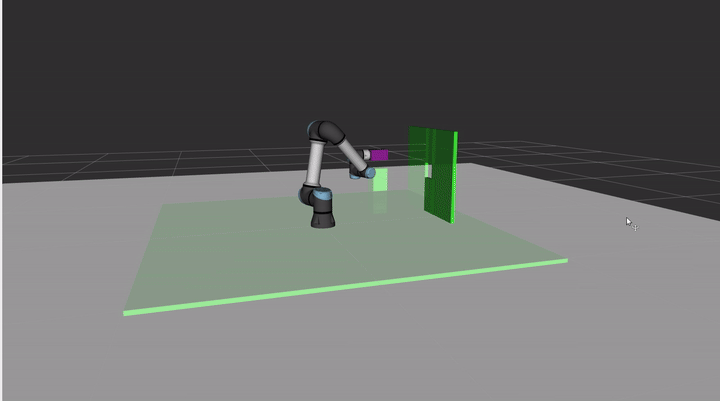
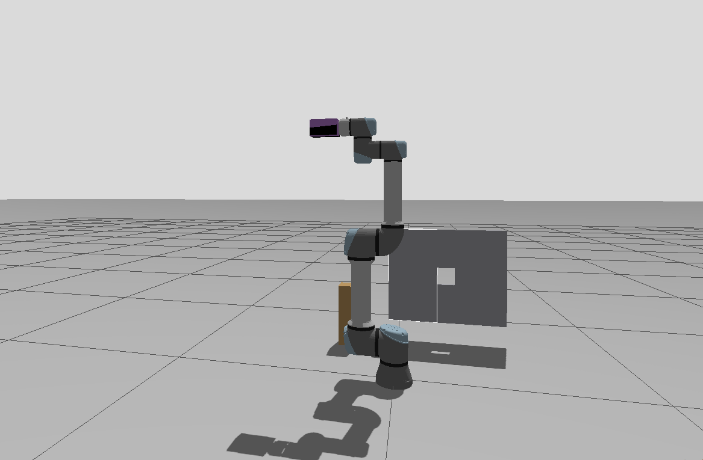

# rh-cell — Remote-Handling Cell

A simulated remote-handling cell inspired by ITER divertor maintenance. A UR5e removes a cassette from a pedestal, inserts it through a tight port in a wall (10 mm clearance per side), extracts it, and puts it back.

**Stack:** ROS 2 Jazzy · MoveIt 2 · Gazebo Harmonic · C++17



*Phase 1.1: remove the cassette from the pedestal, insert it through the 90 mm port, extract, put it back (MoveIt 2, 16 steps, played at 1.5x). The two approach points use taught joint configurations: a pose goal lets MoveIt pick any of the UR's inverse-kinematics solutions, and some of them cannot make the following straight-line move. Straight moves wait for the arm to settle and are re-planned if move_group rejects the start state.*

## Roadmap

| Phase | Content | Status |
|---|---|---|
| 1.1 | Cell layout + scripted remove / insert / extract sequence | ✅ |
| 1.2 | Force/torque sensing + impedance-controlled insertion with a force limit | ⏳ |
| 1.3 | Gamepad teleoperation with virtual fixtures | ⏳ |
| 2 | EPICS signals (caproto) + OpenPLC interlock (IEC 61131-3) + Phoebus operator screen | ⏳ |
| 3 | Fault injection, FMEA, demo video | ⏳ |

## Phase 1.2 progress: force/torque sensor check



A 6-axis force/torque sensor sits on a fixed joint between `tool0` and a 0.5 kg cassette (`urdf/rh_cell_ur.urdf.xacro`). The joint is kept with `preserveFixedJoint`, otherwise Gazebo merges it and the sensor has nothing to measure. Before any force control, the sensor must read the cassette's weight at rest:

| | Measured | Expected |
|---|---|---|
| Force | F_y = 4.900 N | m·g = 0.5 kg × 9.8 m/s² = 4.900 N (Gazebo's default gravity) |
| Torque | τ_x = −0.3185 N·m | τ = r × F with r = 65 mm to the cassette's centre of mass: −0.065 × 4.9 = −0.3185 N·m |

The force appears on the tool's y axis because in the start pose that axis points down; the sensor reports in its own frame.

Damping choice for the admittance controller (offline test in `rh_cell_core`): D = 60 N·s/m gives 1.2 mm tracking lag, D = 200 N·s/m gives 4 mm ([plot](docs/contact_force_D200.png)).

```bash
ros2 launch ur_simulation_gz ur_sim_control.launch.py ur_type:=ur5e launch_rviz:=false \
  description_file:=$HOME/rh_cell_ws/src/rh-cell/urdf/rh_cell_ur.urdf.xacro \
  world_file:=$HOME/rh_cell_ws/src/rh-cell/worlds/rh_cell.sdf
gz topic -e -t /rh/ft -n 1
```

## Cell layout (metres, robot base frame)

| Object | Size | Centre |
|---|---|---|
| Wall | 0.02 thick, port 0.09 × 0.09 | x = 0.60, port at (y −0.25, z 0.35) |
| Cassette | 0.12 × 0.07 × 0.07 | starts at (0.45, 0.25, 0.35) |
| Pedestal | 0.10 × 0.10 × 0.31 | (0.45, 0.25) |

Insertion is along +x with the tool z-axis aligned to +x. At full insertion, the cassette's rear face is flush with the wall's front face.

## Build

```bash
mkdir -p ~/rh_cell_ws/src && cd ~/rh_cell_ws/src
git clone https://github.com/<your-username>/rh-cell.git
cd ~/rh_cell_ws
rosdep install --from-paths src --ignore-src -y
colcon build --symlink-install
source install/setup.bash
```

## Run

Terminal 1 — simulation + MoveIt + RViz:
```bash
ros2 launch ur_simulation_gz ur_sim_moveit.launch.py ur_type:=ur5e
```

Terminal 2 — wait until RViz shows the robot, then:
```bash
source ~/rh_cell_ws/install/setup.bash
ros2 run rh_cell_tasks insertion_sequence --ros-args -p use_sim_time:=true
```

The cell appears in RViz as green collision objects. The cassette turns purple when it is attached to the tool. The robot executes 16 steps and logs each one; the Gazebo window shows only the robot for now.

## Troubleshooting

| Symptom | Fix |
|---|---|
| `move_group not found` | Start terminal 1 first and wait for RViz to load |
| `Didn't receive robot state with recent timestamp` | Add `-p use_sim_time:=true` |
| Gazebo crashes or shows a black window in WSL | `export LIBGL_ALWAYS_SOFTWARE=1` before launching |
| `Straight-line path only xx% feasible` on approach | Increase the gap: lower `kToolToCasCentre` slightly or move `kGraspX` back |
| Planning fails at pre-insert | Raise `setPlanningTime` to 10 s, or move the port closer to the robot |
