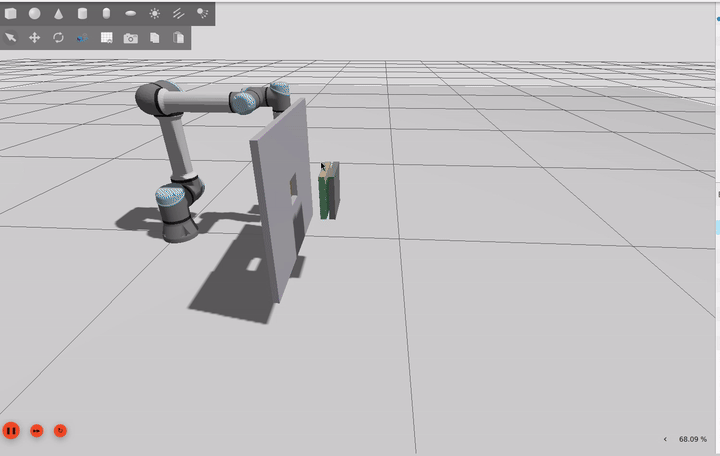
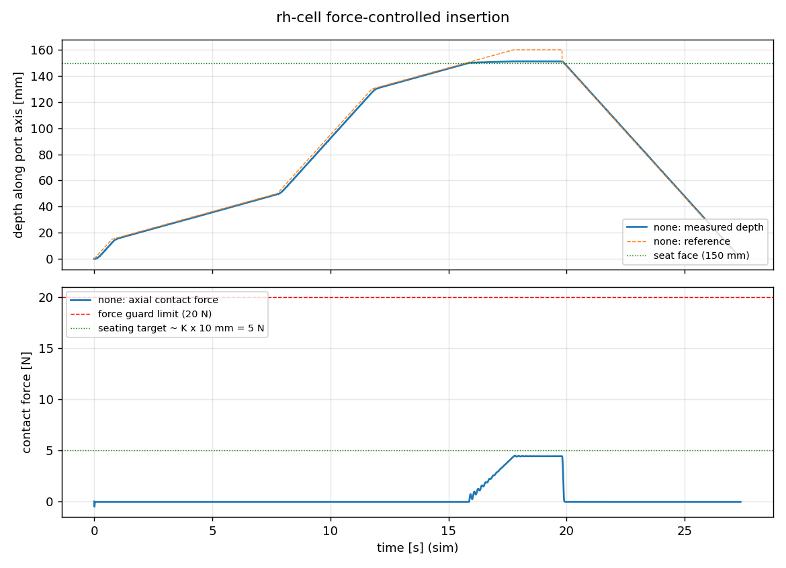
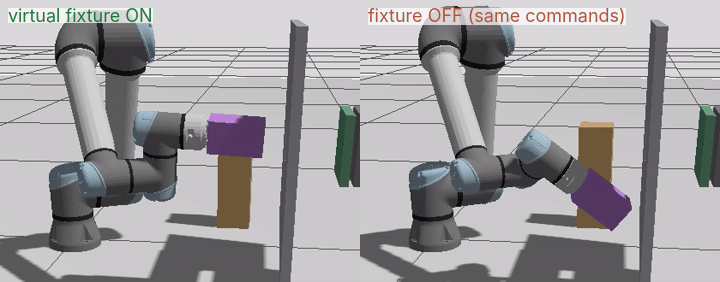
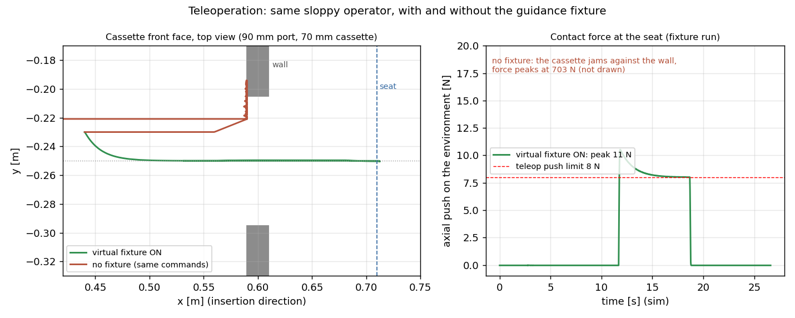
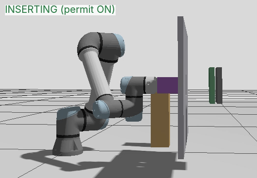
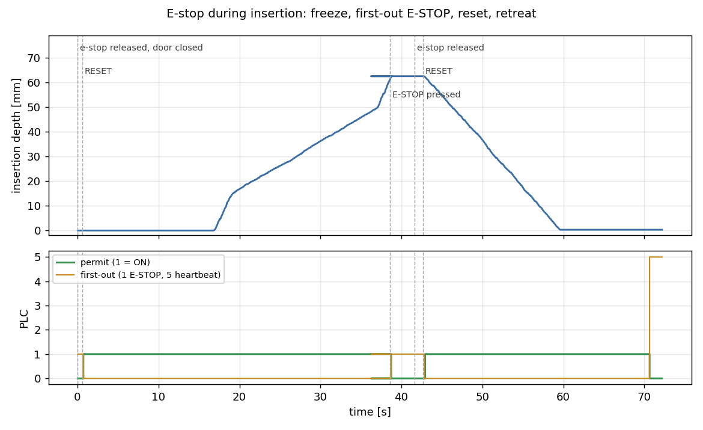
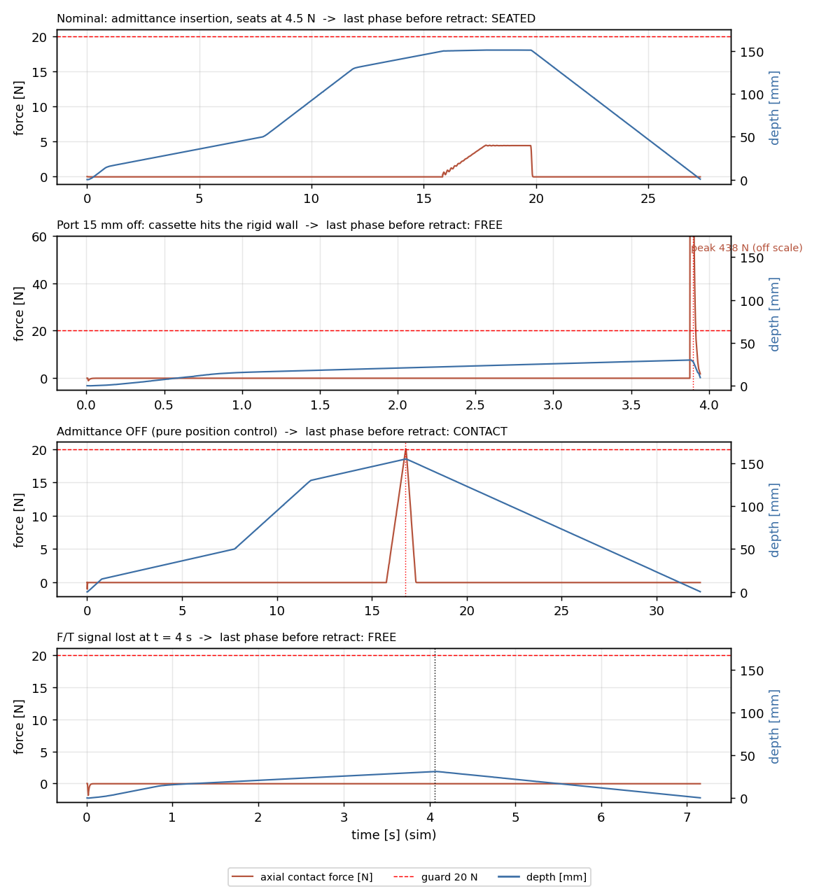
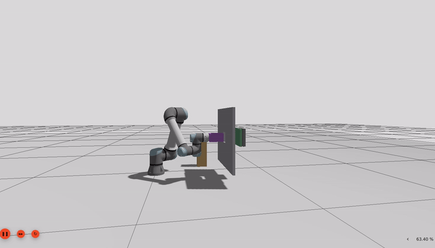

# rh-cell — Remote-Handling Cell

A simulated remote-handling cell inspired by ITER divertor maintenance. A UR5e removes a cassette from a pedestal, inserts it through a tight port in a wall (10 mm clearance per side), extracts it, and puts it back.

**Stack:** ROS 2 Jazzy · MoveIt 2 · Gazebo Harmonic · C++17


*Phase 1.1: remove the cassette from the pedestal, insert it through the 90 mm port, extract, put it back (MoveIt 2, 16 steps, played at 1.5x). The two approach points use taught joint configurations: a pose goal lets MoveIt pick any of the UR's inverse-kinematics solutions, and some of them cannot make the following straight-line move. Straight moves wait for the arm to settle and are re-planned if move_group rejects the start state.*

## Roadmap

| Phase | Content | Status |
|---|---|---|
| 1.1 | Cell layout + scripted remove / insert / extract sequence | ✅ |
| 1.2 | Force/torque sensing + admittance-controlled insertion with a force limit | ✅ |
| 1.3 | Teleoperation with a guidance virtual fixture, push limit and dead-man | ✅ |
| 2 | EPICS signals (caproto) + OpenPLC interlock (IEC 61131-3) + Phoebus operator screen | ✅ |
| 3 | Fault injection + FMEA ([docs/FMEA.md](docs/FMEA.md)) | ✅ |

## Phase 1.2 progress: force/torque sensor check


A 6-axis force/torque sensor sits on a fixed joint between `tool0` and a 0.5 kg cassette (`urdf/rh_cell_ur.urdf.xacro`). The joint is kept with `preserveFixedJoint`, otherwise Gazebo merges it and the sensor has nothing to measure. Before any force control, the sensor must read the cassette's weight at rest:

| | Measured | Expected |
|---|---|---|
| Force | F_y = 4.900 N | m·g = 0.5 kg × 9.8 m/s² = 4.900 N (Gazebo's default gravity) |
| Torque | τ_x = −0.3185 N·m | τ = r × F with r = 65 mm to the cassette's centre of mass: −0.065 × 4.9 = −0.3185 N·m |

The force appears on the tool's y axis because in the start pose that axis points down; the sensor reports in its own frame.

Damping choice for the admittance controller (offline test in `rh_cell_core`): D = 60 N·s/m gives 1.2 mm tracking lag, D = 200 N·s/m gives 4 mm ([plot](docs/contact_force_D200.png)).

```bash
ros2 launch rh_cell_bringup sim.launch.py
ros2 topic echo /rh/ft --once      # 4.90 N on tool y; about 375 Hz on a laptop (ros2 topic hz /rh/ft)
```

## Phase 1.2: force-controlled insertion



`force_insertion` brings the cassette to the port with MoveIt (taught joint configuration), tares the F/T sensor, switches to `forward_position_controller` and runs a 250 Hz loop in sim time:

- **Reference** depth along the port axis: fast in free space, slow through the port mouth and near the seat, ending 10 mm **behind** the seat face on purpose.
- **Admittance** `M·a + D·v + K·(x − x_des) = F` (M = 2 kg, D = 60 N·s/m, K = 500 N/m) turns that 10 mm into a bounded push instead of a collision.
- **Cartesian streaming**: every 4 ms one damped-least-squares IK step (q̇ = J⁺v) turns the tool target into joint positions.
- **Safety layer**: force guard (|F| > 20 N for 5 samples), insertion monitor (contact before the expected depth), 50 ms sensor watchdog, joint tracking check. Any of them stops and backs out.



| Result (laptop, WSL2) | Value |
|---|---|
| Seated depth | 151.1 mm (seat face at 150 mm) |
| Steady seating force | 4.5 N = 10 mm × (500 · 5000 / 5500): virtual spring in series with the 5 kN/m seat |
| Peak force | 5.2 N. The small oscillation at first touch is the spring-loaded seat plate, damped within ~1 s |
| Cycle (insert, hold 2 s) | 19.8 s sim time |

```bash
ros2 launch rh_cell_bringup sim.launch.py
ros2 run rh_cell_tasks force_insertion
ros2 run rh_cell_tasks plot_run.py
```

## Phase 1.3: teleoperation with a virtual fixture



The operator drives the tool in world x/y/z (orientation locked) with `teleop_twist_keyboard` or the scripted operator `teleop_demo.py`. Near the port, the virtual fixture (`rh_cell_core/virtual_fixture.hpp`, no ROS, unit-tested):

- passes only 10% of sideways commands and pulls the tool back onto the port axis,
- blocks forward motion while the tool is more than 4 mm off the axis, so the cassette cannot be driven into the wall,
- plus a push limit (forward motion cut above 8 N) and a dead-man (no command for 0.3 s means stop).

**Same scripted commands in both runs** (start 20 mm off-axis, drift sideways while going in, keep pushing at the seat). This shows the fixture correcting a sloppy operator; it is not a study with human operators.



| | Fixture ON | Fixture OFF |
|---|---|---|
| Through the port | Yes, to the seat | No, jammed at the wall |
| Push on the environment | 11 N briefly, then held at the 8 N limit | 703 N against the wall |

```bash
ros2 launch rh_cell_bringup sim.launch.py
ros2 run rh_cell_tasks teleop_fixture                     # add  --ros-args -p use_fixture:=false  to compare
ros2 run rh_cell_tasks teleop_demo.py                     # after "Teleop active"; or teleop_twist_keyboard:
ros2 run teleop_twist_keyboard teleop_twist_keyboard --ros-args -r cmd_vel:=/rh/teleop_cmd
```

## Phase 2: interlock and EPICS operator interface



The motion permit is a **latch**, like a safety relay: set only by a RESET rising edge while all five inputs are healthy, dropped immediately when any input fails, never restarted automatically. The first input that dropped is reported (**first-out**), so the operator sees the cause, not the cascade. A signal that stops arriving counts as unhealthy (fail-safe).

| # | Input (1 = healthy) | Source |
|---|---|---|
| 1 | E-stop chain | operator PV `RH:ESTOP_OK` |
| 2 | Cell door closed | operator PV `RH:DOOR_CLOSED` |
| 3 | Force guard not tripped | task node |
| 4 | F/T sensor alive | raw sensor topic **and** the task node's watchdog |
| 5 | Controller heartbeat | 10 Hz from the task node |

- `rh_cell_ic/interlock.py`: the logic (soft PLC), and the same logic in IEC 61131-3 Structured Text (`plc/rh_cell_interlock.st`) for the OpenPLC runtime over Modbus TCP, with a watchdog counter so a crashed bridge cannot leave the permit on.
- `epics_ioc.py`: EPICS Channel Access IOC (caproto), 16 PVs (`RH:PERMIT`, `RH:FIRST_OUT_STR`, `RH:ESTOP_OK`, `RH:RESET`, …); `phoebus/rh_cell.bob` is the operator screen for CS-Studio Phoebus.
- `force_insertion` with `require_permit:=true` waits for the permit, stops MoveIt when it drops, and freezes the streamed insertion. After an e-stop, door or heartbeat trip nothing moves until reset; after a force or sensor fault the controller may back out on its own.



The plot is the exact record (EPICS PVs logged by the scripted operator `estop_demo`); the labels in the GIF above were placed from the video. Sequence: RESET, insertion, **e-stop at 60 mm: frozen**, release (still frozen: no automatic restart), RESET, retreat. At the end the task node exits, its heartbeat stops, and the permit drops with first-out HEARTBEAT LOST.

```bash
ros2 launch rh_cell_bringup sim.launch.py ic:=true
ros2 run rh_cell_tasks force_insertion --ros-args -p require_permit:=true
ros2 run rh_cell_ic estop_demo          # or: python3 -m caproto.commandline.put RH:ESTOP_OK 0 / RH:RESET 1
```

**Limits:** a functional demonstration of interlock logic, not a safety-rated design. A real permit runs on a safety PLC with hard-wired e-stop and door channels, not over Modbus TCP. The OpenPLC path is tested against a minimal Modbus server running the same logic, not against the OpenPLC runtime itself.

## Phase 3 (part 1): fault injection

Each fault is injected on purpose; the safety layer must catch it and back the cassette out.

```bash
ros2 run rh_cell_tasks force_insertion --ros-args -p fault:=misaligned   # or stiff, sensor_dropout
```

| Injected fault | Models | Caught by | Result (laptop, WSL2) |
|---|---|---|---|
| none | — | — | SEATED, 151.2 mm, peak 5.7 N |
| `misaligned` | Robot believes the port is 15 mm further along +y than it is (calibration error / arm deflection) | Force guard, 5 samples > 20 N | Stopped at 30.0 mm (wall face), backed out; **peak 438 N** in the plotted run (263–465 N across runs) |
| `stiff` | Admittance off: pure position control into the seat | Force guard | Tripped at 20.1 N, 155.1 mm deep |
| `sensor_dropout` | F/T stream cut 4 s into the insertion | 50 ms watchdog | Stopped at 30.9 mm, backed out |





*Top view of `fault:=misaligned`: the cassette stops at the wall face (grey line) instead of passing through to the seat (green), the force guard trips, and the arm backs out. The opening is hidden from above by the wall piece over the port.*

**The misaligned case is the important one.** Detection is consistent (always 30.0 mm, 5 samples), but the impact peak is not: 438 N in the plotted run, 263, 447 and 465 N in other runs of the same code, and slowing the approach from 5 to 1 mm/s barely changes it. Against a rigid obstacle, the first impact is set by contact and joint stiffness, not by the control loop: software limits how long the overload lasts, not how high it goes. That is why the seat in this cell is spring-loaded, and why real remote-handling systems rely on passive compliance and on checking alignment *before* contact (vision, in ITER's case) rather than on force control alone.

## Phase 3 (part 2): FMEA

[docs/FMEA.md](docs/FMEA.md): 14 failure modes of the cell (insertion physics, sensor, interlock, teleoperation, planning), each with detection, mitigation, severity / occurrence / detection ratings and the run or test that exercises it. The highest-risk line is a **frozen or biased F/T sensor** (RPN 147): the watchdog only detects data that stops arriving, not data that is wrong. The most instructive line is the misaligned port: detection is reliable, but the impact peak can only be bounded outside the force loop (compliance, alignment check before contact).

## Cell layout (metres, robot base frame)

| Object | Size | Centre |
|---|---|---|
| Wall | 0.02 thick, port 0.09 × 0.09 | x = 0.60, port at (y −0.25, z 0.35) |
| Cassette | 0.12 × 0.07 × 0.07 | starts at (0.45, 0.25, 0.35) |
| Pedestal | 0.10 × 0.10 × 0.31 | (0.45, 0.25) |

Insertion is along +x with the tool z-axis aligned to +x. At full insertion, the cassette's rear face is flush with the wall's front face.

## Build

```bash
mkdir -p ~/rh_cell_ws/src && cd ~/rh_cell_ws/src
git clone https://github.com/ashishdevadas/rh-cell.git
cd ~/rh_cell_ws
rosdep install --from-paths src --ignore-src -y
colcon build --symlink-install
source install/setup.bash
```

## Run

### Phase 1.2 cell: robot with F/T sensor and cassette, cell world, MoveIt, RViz

```bash
ros2 launch rh_cell_bringup sim.launch.py
```
One command starts Gazebo with `rh_cell_description` (robot + world), the F/T bridge (`/rh/ft`), MoveIt 2, RViz with `rh_cell_bringup/config/rh_cell.rviz`, and loads `forward_position_controller` inactive for force control. Do not run `insertion_sequence` with this launch: here the cassette is fixed to the tool in Gazebo, so it would hit the pedestal.

### Phase 1.1 scripted sequence (stock UR simulation, cell as MoveIt collision objects)

Terminal 1 — simulation + MoveIt + RViz:
```bash
ros2 launch ur_simulation_gz ur_sim_moveit.launch.py ur_type:=ur5e
```

Terminal 2 — wait until RViz shows the robot, then:
```bash
source ~/rh_cell_ws/install/setup.bash
ros2 run rh_cell_tasks insertion_sequence --ros-args -p use_sim_time:=true
```

The cell appears in RViz as green collision objects. The cassette turns purple when it is attached to the tool. The robot executes 16 steps and logs each one; the Gazebo window shows only the robot for now.

## Troubleshooting

| Symptom | Fix |
|---|---|
| `move_group not found` | Start terminal 1 first and wait for RViz to load |
| `Didn't receive robot state with recent timestamp` | Add `-p use_sim_time:=true` |
| Gazebo crashes or shows a black window in WSL | `export LIBGL_ALWAYS_SOFTWARE=1` before launching |
| `Straight-line path only xx% feasible` | The chosen arm configuration cannot make the straight move; this is why the approach points use taught joint values (`kPreGraspQ`, `kPreInsertQ`) |
| Forces of thousands of newtons, frame `ur_0/...` | A second robot was spawned into a leftover Gazebo: `pkill -f "gz sim"`, check with `ps aux \| grep "gz sim"`, relaunch |
| `Execute request aborted` right after a straight move | The arm had not settled (start-state tolerance 0.01 rad); straight moves wait 0.3 s and retry |
